<!--
  ╔══════════════════════════════════════════════════════╗
  ║  WhoGotPwned · Security Researcher · Offensive Dev   ║
  ╚══════════════════════════════════════════════════════╝
-->

<div align="center">



<br/><br/>

<a href="https://git.io/typing-svg">
  
</a>

<br/>


<br/><br/>

<a href="#-whoami"></a>
&nbsp;<a href="#-stack"></a>
&nbsp;<a href="#-focus"></a>
&nbsp;<a href="#-stats"></a>
&nbsp;<a href="#-latest-activity"></a>
&nbsp;<a href="#-connect"></a>
&nbsp;<a href="#-support"></a>

</div>

<br/>


## 🧬 Whoami

<table>
<tr>
<td width="55%" valign="top">

```bash
$ cat ~/.profile

handle    : WhoGotPwned
role      : Security Researcher & Offensive Developer
location  : somewhere between /dev/null and root
uptime    : hunting bugs since before it was cool

interests :
  ├── Vulnerability Research & Bug Bounty
  ├── Red Team / Penetration Testing
  ├── Secure-by-Design Engineering
  └── AI-Driven Security Automation

motto     : "Break it. Understand it. Build it better."
```

</td>
<td width="45%" valign="top">

**I live at the intersection of offensive security, open source and secure-by-design engineering.**

I write exploits *and* the patches for them. When I'm not hunting CVEs, I'm building tools for pentesters and defenders, pushing code, and helping people harden their digital frontier.

<br/>

- 🔍 &nbsp;Active in **bug bounty** & security advisories
- 🛠️ &nbsp;**Toolsmith** for red & blue teams
- 🤖 &nbsp;Exploring **AI for offense & defense**
- 📖 &nbsp;Always learning, always breaking stuff

</td>
</tr>
</table>

<br/>


## ⚡ Stack

<div align="center">

**Languages**

<a href="https://skillicons.dev"></a>

**Platforms & Infra**

<a href="https://skillicons.dev"></a>

**Security Tooling**


</div>

<br/>


## 🎯 Focus

<table align="center">
<tr>
<td width="33%" valign="top" align="center">

### 🔴 Offensive

<br/>

Penetration Testing<br/>
Exploit Development<br/>
Red Team Operations<br/>
Web & API Security<br/>
Reverse Engineering

</td>
<td width="33%" valign="top" align="center">

### 🔵 Defensive

<br/>

Secure Code Review<br/>
Threat Modeling<br/>
Incident Response<br/>
Hardening & Detection<br/>
Applied Cryptography

</td>
<td width="33%" valign="top" align="center">

### 🟣 Research

<br/>

Vulnerability Research<br/>
Bug Bounty<br/>
AI-Assisted Security<br/>
Open-Source Tooling<br/>
CVE Hunting

</td>
</tr>
</table>

<br/>


## 📊 Stats

<div align="center">


<br/><br/>

<picture>
  <source media="(prefers-color-scheme: dark)" srcset="https://raw.githubusercontent.com/WhoGotPwned/WhoGotPwned/output/github-contribution-grid-snake-dark.svg" />
  <source media="(prefers-color-scheme: light)" srcset="https://raw.githubusercontent.com/WhoGotPwned/WhoGotPwned/output/github-contribution-grid-snake.svg" />
  
</picture>

</div>

<br/>


## 🔥 Latest Activity

<!--START_SECTION:activity-->
1. 🎉 Merged PR [#1](https://github.com/whogotpwned/whogotpwned/pull/1) in [whogotpwned/whogotpwned](https://github.com/whogotpwned/whogotpwned)
2. 💪 Opened PR [#1](https://github.com/whogotpwned/whogotpwned/pull/1) in [whogotpwned/whogotpwned](https://github.com/whogotpwned/whogotpwned)
3. ❗ Opened issue [#3](https://github.com/dragosol/hyprdrive-omarchy/issues/3) in [dragosol/hyprdrive-omarchy](https://github.com/dragosol/hyprdrive-omarchy)
<!--END_SECTION:activity-->

<sub>Auto-updated every 6 hours by GitHub Actions.</sub>

<br/>


## 🚩 TryHackMe

<div align="center">

<a href="https://tryhackme.com/p/whogotpwned" target="_blank">
  
</a>

</div>

<br/>


## 🌐 Connect

<div align="center">

<a href="https://security.stackexchange.com/users/307956/localhostport80" target="_blank">
  
</a>

</div>

<br/>


## 💜 Support

<div align="center">

If my tools or research saved you time, you can fuel the next one with ETH:

<br/>

<a href="https://etherscan.io/address/0xD6ab356E1174F3C21fFfe85831512C5F915Fcf2c" target="_blank">
  
</a>

<br/><br/>

<a href="https://etherscan.io/address/0xD6ab356E1174F3C21fFfe85831512C5F915Fcf2c" target="_blank">
  
</a>

```
0xD6ab356E1174F3C21fFfe85831512C5F915Fcf2c
```

<sub>ETH & ERC-20 tokens · Ethereum mainnet · scan or copy</sub>

</div>

<br/>


<div align="center">

<sub><b>Hacking the planet, one commit at a time.</b></sub>

</div>
